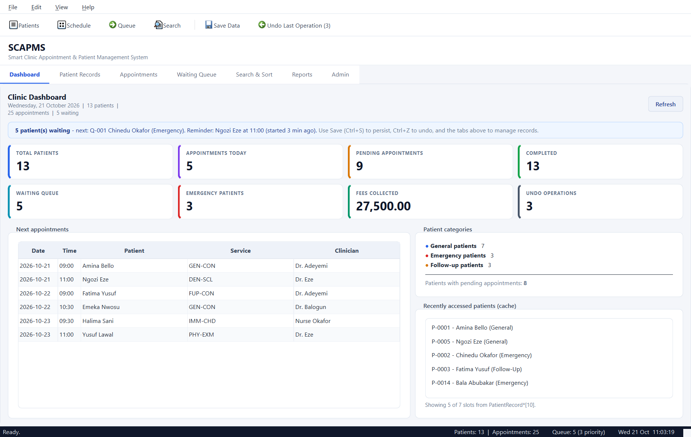
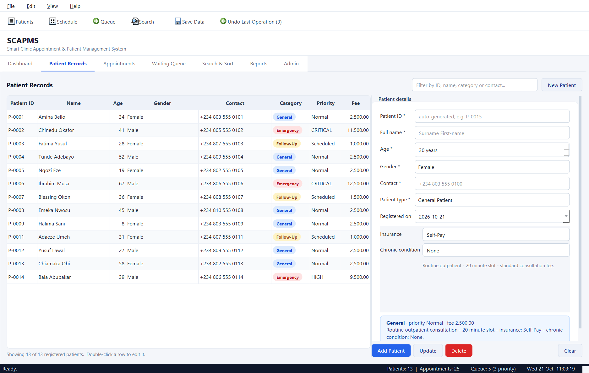
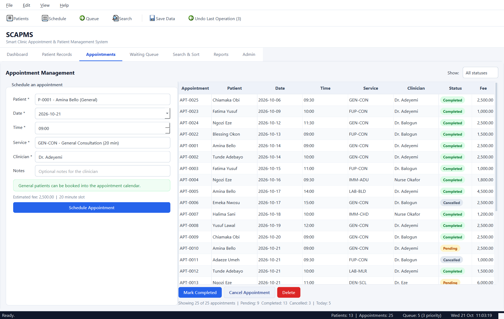
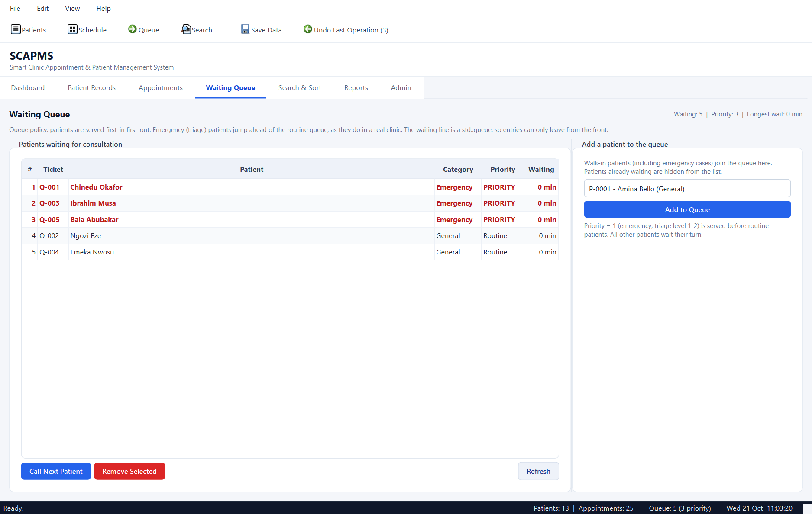
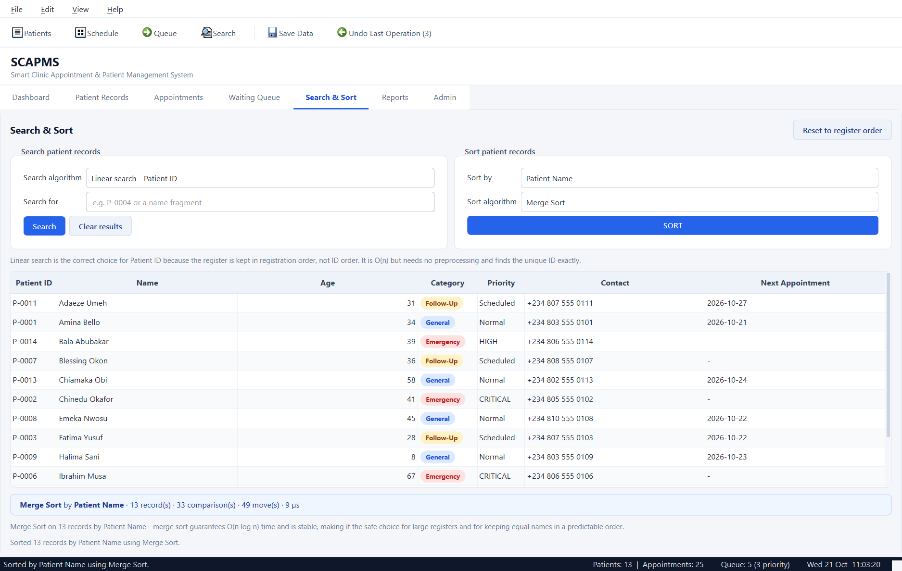
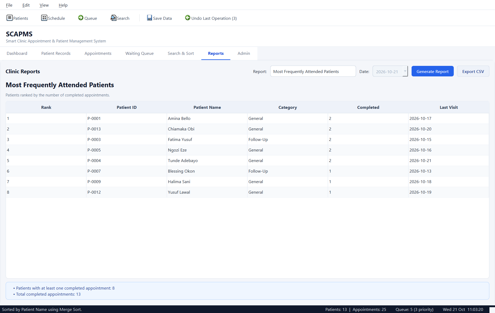
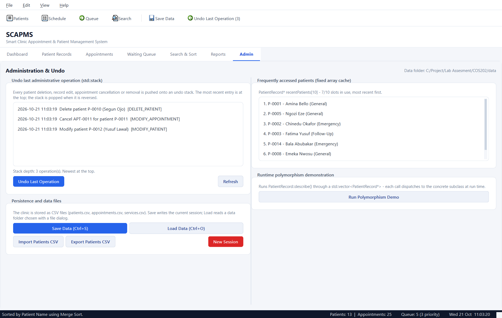

# SCAPMS — Smart Clinic Appointment & Patient Management System

**COS202 Programming II — Lab Assessment Project**
A complete C++17 / Qt 6 Widgets desktop application for a university clinic: patient
registration, appointments, a triage-aware waiting queue, student-written searching and
sorting, an undo stack, CSV persistence and clinic reports.

> **Submission report (PDF):**
> [`submission/COS202_SCAPMS_Submission_Report.pdf`](submission/COS202_SCAPMS_Submission_Report.pdf)
> — project report, UML class diagrams, seven screenshots, core source listings and the
> requirement traceability matrix.



---

## 1. What the application does

| Area | Capabilities |
|------|--------------|
| **Patients** | Register, edit and delete General / Emergency / Follow-Up patients. The form's extra fields change with the patient type. Live filter, category colour coding, automatic ID allocation. |
| **Appointments** | Schedule, complete, cancel and delete appointments. Rejects past dates, unknown patients/services, clinician double-bookings and non-bookable emergency patients. |
| **Waiting queue** | `std::queue` with a priority lane for emergency (triage) cases; issue tickets, call the next patient, remove entries, live waiting-time alerts. |
| **Search & sort** | Four hand-written search techniques and four hand-written sort algorithms with live comparison/move/time statistics and an explanation of why each algorithm suits the data. |
| **Reports** | Most frequently attended patients, pending appointments, category distribution, daily appointment summary and revenue by service — exportable to CSV. |
| **Admin** | Undo stack viewer (`std::stack`), save/load, CSV import/export, new session, fixed-size recent-patient cache, runtime-polymorphism demonstration. |

### Screenshots

| Patient records | Appointments |
|---|---|
|  |  |

| Waiting queue | Search & sort |
|---|---|
|  |  |

| Reports | Administration & undo |
|---|---|
|  |  |

---

## 2. Requirement coverage

The full requirement-by-requirement traceability matrix is in
[`REQUIREMENTS_MATRIX.md`](REQUIREMENTS_MATRIX.md).

Highlights:

* **Abstract class** `PatientRecord` with five pure virtual operations and three concrete
  subclasses (`GeneralPatient`, `EmergencyPatient`, `FollowUpPatient`).
* **Interface** `Appointable` implemented through `AppointableImpl` by the two patient
  types that can be booked; emergency patients deliberately stay walk-in only.
* **Polymorphism** demonstrated by `ClinicManager::describeAllPatients()` and by the Admin
  panel's "Run Polymorphism Demo".
* **Composition** — `ClinicDatabase` owns the patients and appointments; `Appointment`
  references a patient and a `MedicalService`.
* **Data structures** — `std::vector` (patients), `std::queue` (two waiting lanes),
  `std::stack` (undo), raw fixed-size array `PatientRecord* recentPatients[10]` (cache).
* **Four hand-written sorting algorithms** (selection, insertion, recursive merge, quick)
  over four keys (name, ID, age, earliest appointment date).
* **Three hand-written searches** (linear by ID, binary by name/ID on sorted data,
  recursive name scan) plus category filtering and a data-aware "Automatic" mode.
* **Five custom exception classes** deriving from
  `ClinicException : std::runtime_error` (`ValidationException`, `DuplicateIdException`,
  `NotFoundException`, `AppointmentException`, `FileException`).
* **CSV persistence** with round-trip validation and readable `FileException` messages.

---

## 3. Project layout

```
SCAPMS.pro                  qmake project
CMakeLists.txt              CMake project (Qt 6)
resources/
  resources.qrc             Qt resource file
  style.qss                 application stylesheet
src/
  main.cpp                  entry point (GUI / --selftest / --capture)
  model/                    pure C++ domain layer (no Qt types)
    PatientRecord.*         abstract base class
    GeneralPatient.*        routine outpatient
    EmergencyPatient.*      triage / walk-in
    FollowUpPatient.*       scheduled review
    Appointable.h/.cpp      interface + reusable implementation
    Appointment.*           appointment value object
    MedicalService.*        service catalogue
    PatientFactory.*        CSV -> concrete subclass
    ClinicDatabase.*        repository, cache, persistence
  controller/               business logic (pure C++)
    ClinicManager.*         facade: validation, queue, undo, stats
    AppointmentController.* booking rules and status transitions
    SearchEngine.*          linear / binary / recursive search
    SortEngine.*            selection / insertion / merge / quick sort
    AdminCommand.*          command objects for the undo stack
    ReportGenerator.*       five reports
    DemoData.*              first-run demonstration clinic
  gui/                      Qt Widgets presentation layer
    MainWindow.*            menus, toolbar, status bar, timers, tabs
    DashboardPanel.*        statistics, next appointments, cache preview
    PatientPanel.*          table + dynamic registration form
    AppointmentPanel.*      scheduling form + appointment table
    QueuePanel.*            waiting queue table + ticket actions
    SearchPanel.*           search/sort controls and result table
    ReportPanel.*           report viewer + CSV export
    AdminPanel.*            undo stack, persistence, cache, polymorphism demo
    PillDelegate.*          custom category/status rendering
    UiHelpers.*             stylesheet, colours, card factory
  utils/                    dependency-free helpers
    Exceptions.h            custom exception hierarchy
    StringUtils.*           trim, case-insensitive compare, CSV escaping
    DateUtils.*             ISO date arithmetic, validation, weekdays
    IDGenerator.*           P-0001 / APT-0001 identifiers
    FileHandler.*           exception-safe text-file I/O
tests/
  SelfTest.*                --selftest harness (279 checks)
data/                       patients.csv, appointments.csv, services.csv
screenshots/                generated by --capture
```

The **model**, **controller** and **utils** layers contain no Qt GUI types at all; the GUI
converts `std::string` to `QString` at its boundary. This keeps the domain testable without
an event loop and demonstrates a genuine separation of responsibilities.

---

## 4. Building

### Prerequisites

* Qt 6.5+ with the **Widgets** module (developed against **Qt 6.8.3, MinGW 13.1, 64-bit**)
* A C++17 compiler (MinGW 13.1 or MSVC 2022+)
* `qmake` + `mingw32-make`, or CMake 3.21+

### qmake (verified build)

```bat
set PATH=C:\Qt\Tools\mingw1310_64\bin;C:\Qt\6.8.3\mingw_64\bin;%PATH%
mkdir build
cd build
qmake ..\SCAPMS.pro
mingw32-make -j4
```

### CMake (verified build)

```bat
cmake -S . -B build-cmake -G "MinGW Makefiles" ^
      -DCMAKE_PREFIX_PATH=C:/Qt/6.8.3/mingw_64
cmake --build build-cmake -j 4
```

The executable is `SCAPMS.exe`. When launched from the repository it finds `data/` next to
the build folder automatically; otherwise pass `--data`.

---

## 5. Running

```bat
SCAPMS.exe                          :: start the GUI (loads ./data, seeds demo on first run)
SCAPMS.exe --data C:\clinic-data    :: use a specific data folder
SCAPMS.exe --selftest               :: run the automated test suite (exit code = failures)
SCAPMS.exe --capture screenshots    :: render every tab to PNG and exit
```

`--selftest` needs no display and prints a pass/fail report. Current result:

```
Passed: 279   Failed: 0
RESULT: ALL CHECKS PASSED
```

### Keyboard shortcuts

| Shortcut | Action |
|----------|--------|
| `Ctrl+N` | New session |
| `Ctrl+O` | Load data folder |
| `Ctrl+S` | Save data |
| `Ctrl+Z` | Undo last administrative operation |
| `Ctrl+F` | Find patient (jumps to the patient filter) |
| `F5` | Refresh every panel |
| `Ctrl+1` … `Ctrl+7` | Switch to Dashboard / Patients / Appointments / Queue / Search / Reports / Admin |
| `Ctrl+Q` | Exit |

---

## 6. Data files

`patients.csv`

```
# type,id,name,age,gender,contact,registeredOn,field1,field2,field3
GENERAL,P-0001,Amina Bello,34,Female,+234 803 555 0101,2026-10-21,NHIS,Hypertension
EMERGENCY,P-0002,Chinedu Okafor,41,Male,+234 805 555 0102,2026-10-21,2,Ambulance,yes
FOLLOWUP,P-0003,Fatima Yusuf,28,Female,+234 807 555 0103,2026-10-21,2026-09-21,14,Dr. Adeyemi
```

`appointments.csv`

```
# id,patientId,date,time,serviceCode,clinician,status,fee,notes
APT-0001,P-0001,2026-10-14,09:00,GEN-CON,Dr. Adeyemi,Completed,2500.00,Blood pressure review
```

`services.csv` — service catalogue (`code,name,category,durationMinutes,baseFee`).
Fields are CSV-escaped, comments start with `#`, and malformed rows raise a
`FileException` naming the file and line number instead of crashing.

---

## 7. Algorithms and design notes

### Searching

| Technique | Where | Cost | Why |
|-----------|-------|------|-----|
| Linear by ID | unsorted register | O(n) | the register is kept in registration order, so no index exists; needs no preprocessing |
| Binary by name | sorted snapshot | O(log n) | the sort button creates the ordering that makes the logarithmic search valid |
| Binary by ID | data sorted by ID | O(log n) | included to show a second sorted key |
| Recursive name scan | any order | O(n) | partial-name matching; the empty index is the base case |
| Category filter | any order | O(n) | categorical match cannot benefit from ordering |
| Automatic | inspects the data | O(log n) or O(n) | demonstrates choosing the technique from the state of the data |

### Sorting

| Algorithm | Complexity | Notes |
|-----------|------------|-------|
| Selection sort | O(n²) comparisons, O(n) swaps | good when writes are expensive |
| Insertion sort | O(n²) worst, O(n) nearly sorted | adaptive and stable — the natural choice after a previous sort |
| Merge sort | O(n log n), stable | recursive, predictable for large registers |
| Quick sort | O(n log n) average, in place | median-of-three pivot, best cache behaviour |

All four write into `std::vector<PatientRecord*>`; `std::sort` and friends are never used.
Equal keys fall back to name/ID so every algorithm produces the same total order.

### Undo

`ClinicManager` keeps `std::stack<std::unique_ptr<AdminCommand>>`. The four command types
(`DeletePatientCommand`, `ModifyPatientCommand`, `RemoveAppointmentCommand`,
`ModifyAppointmentCommand`) capture enough state to reverse exactly one mutation — deleting a
patient also stores the appointments that cascaded so that undo restores both.

### Waiting queue

Two `std::queue<QueueEntry>` lanes: emergency (priority 1) and routine. `callNextPatient()`
drains the priority lane first and then serves the routine lane strictly FIFO, matching the
brief's "first to join is normally served first" while reflecting real triage practice.

### Frequent-patient cache

A real fixed-size array, `PatientRecord* m_recent[10]`, maintained as MRU order. Pointers are
valid because `ClinicDatabase` owns patients through `std::unique_ptr`; the array is shifted
and cleared whenever a record is deleted, so it can never dangle.

### Exception strategy

Validation happens in the model (`PatientRecord::validate`) and the controllers
(`ClinicManager`, `AppointmentController`). GUI slots catch `ClinicException` to show a
friendly `QMessageBox`, and fall back to `std::exception` for unexpected errors. File loading
is transactional: data is parsed into temporary containers and only committed when every
record is valid, so a bad file never half-loads a clinic.

---

## 8. Tests

`tests/SelfTest.cpp` (run with `--selftest`) covers:

1. Patient hierarchy, validation, cloning, fee/priority behaviour, exception hierarchy.
2. `Appointable` interface, booking rules, double-booking, status transitions, undo.
3. Linear, binary, recursive and automatic searching (including the unsorted-data refusal).
4. Four sorting algorithms × four keys, cross-algorithm agreement, adaptivity, edge cases.
5. Queue FIFO/priority ordering, removal, deletion from the queue.
6. Undo of delete/modify/cancel with cascade restoration.
7. Fixed-size cache eviction, MRU reordering and deletion invalidation.
8. CSV round trip (14 patients / 25 appointments), missing folder and corrupt-file errors.
9. All five reports against live statistics.
10. Dashboard statistics invariants and polymorphic descriptions.
11. String, CSV and date helpers (leap years, month boundaries, money formatting).
12. Identifier generation and collision avoidance after loading.

---

## 9. Documentation

* **Submission report:** [`submission/COS202_SCAPMS_Submission_Report.pdf`](submission/COS202_SCAPMS_Submission_Report.pdf)
* **Requirement traceability:** [`REQUIREMENTS_MATRIX.md`](REQUIREMENTS_MATRIX.md)
* **Report source:** `docs/report/COS202_SCAPMS_Report.md` (rebuild with
  `powershell -File docs/report/build-report.ps1`)
* **UML sources:** `docs/uml/*.puml` (rendered with PlantUML + Graphviz)

---

## 10. Known limitations

* The waiting queue is session-only data; it is intentionally not written to disk because it
  represents the current clinic day.
* The UI is desktop-only (Qt Widgets) and designed for a 1280×800 or larger window.
* Appointment slots are validated for clinician/time clashes but not for service duration
  overlaps; the catalogue duration is displayed for planning.
